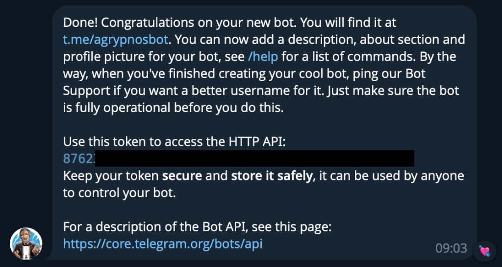
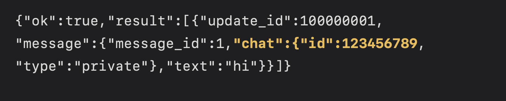
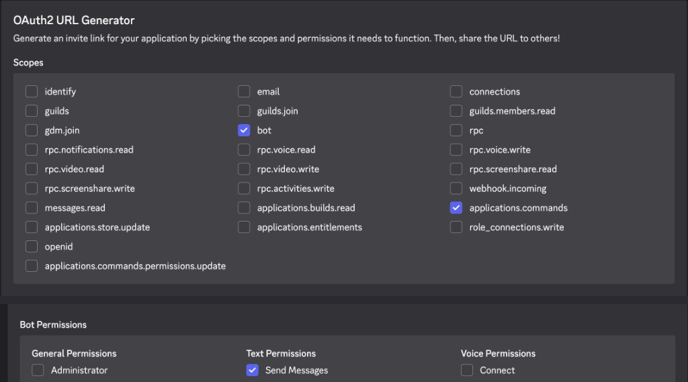

<div align="center">
  
  <h1>Agrypnos</h1>
  <p><b>Close the lid. Your coding agents keep working.</b></p>
  <p>A small macOS menu-bar app that keeps your Mac awake with the lid shut while your agents run, and lets it sleep again when the wait after agent signals stop ends, or when you say so.</p>
  <p>
    <a href="https://github.com/VremennoiParadox/Agrypnos/actions/workflows/core.yml"></a>
    
    
    <a href="LICENSE"></a>
    
  </p>
</div>

<table align="center">
  <tr>
    <td align="center"><b>Watches</b></td>
    <td align="center" width="96"><br>Cursor</td>
    <td align="center" width="96"><br>Claude Code</td>
    <td align="center" width="96"><br>Codex</td>
    <td align="center" width="96"><br>OpenCode</td>
  </tr>
</table>

<p align="center"><i>Greek</i> agrypnos: <i>sleepless.</i></p>

---

## Why this exists

You start a long agent run, close the laptop, and walk away. macOS goes to sleep and the run dies with it.

The usual keep-awake tricks don't help here. Power assertions (what `caffeinate` uses) stop working the moment the lid closes. The one switch that does hold is `pmset disablesleep`, and it's easy to forget to turn off again. Agrypnos flips it for you, turns the screen down while the lid is shut, and flips it back once your timer ends, the wait after agent signals stop ends, or you turn it off.

## What you get

- Turn on **Keep awake** from the menu bar or with `⌥⌘A`. Nothing changes on screen until you close the lid.
- On lid close, the keyboard backlight goes off and the panel dims to a floor you choose. If you prefer, the panel sleeps instead.
- Set How long to **1h**, **3h**, or custom minutes for a countdown that starts when you turn Keep awake on.
- Set How long to **Agents** and Keep awake turns off by itself when the wait after agent signals stop ends.
- Low battery and thermal pressure turn Keep awake off too, and a reboot always clears it.
- If you want, *your* Telegram or Discord bot gets a message when the timer ends or the wait after agent signals stop ends. Discord also messages when Agrypnos asks the Mac to sleep. Either bot takes `/arm`, `/disarm`, `/status`, and `/help` from your phone.
- When OpenCode or Claude Code asks you a multiple-choice question, your bot can show it and send your answer back (BETA). Codex can ping your bot when it's waiting on you.
- No analytics, no accounts, no shared bot. The only privileged piece is a two-command sudoers rule, spelled out in [SECURITY.md](SECURITY.md).

## Install

There's no signed download yet, so you build it yourself. You need macOS 14 or later and Xcode.

```bash
git clone https://github.com/VremennoiParadox/Agrypnos.git
cd Agrypnos
./Scripts/build-macos.sh
open dist/Agrypnos.app
```

An eye appears in the menu bar. That's Agrypnos. It has no Dock icon and no settings window. Everything lives in the menu-bar popover.

The first time you turn Keep awake on, Agrypnos asks to install a small sudoers rule so it can run exactly these two commands without a password:

```
/usr/bin/pmset -a disablesleep 1
/usr/bin/pmset -a disablesleep 0
```

macOS asks for your password once. To remove the rule later, run `./Scripts/ungrant.sh`.

## Quick start

1. Click the eye in the menu bar. The popover opens on **Watch**.
2. Under **How long**, pick **Agents**.
3. Turn on **Keep awake**. The menu-bar eye turns **purple**. The icon stays the same size in every mode: gray when off, blue for ∞, gold when Keep awake is on a timer, and purple for Agents.
4. Start your agent and close the lid.

Agrypnos waits until the lid has really closed (a single flicker of the lid sensor doesn't count), then turns the keyboard backlight off and dims the panel. When the wait after agent signals stop ends (2 minutes by default), Keep awake turns off. If the lid is still closed, Agrypnos also asks the Mac to sleep.

Want it on until you say stop? Pick `∞` instead and turn it off yourself.

> [!NOTE]
> `1h`, `3h`, and custom minutes start a countdown when Keep awake turns on. The time left shows in the How long card. Opening the lid doesn't pause the timer, and changing the duration while Keep awake is on starts a fresh countdown. When the timer ends, Keep awake turns off and Agrypnos asks the Mac to sleep unless the lid is known to be open. If the lid reading is unavailable, it still asks. How long keeps your choice for next time.

## How it works

### When the lid closes

The **Power** section has two panel modes. You pick one.

| Mode | On a confirmed lid close | When you open the lid again |
|---|---|---|
| **Dim panel** (default) | Brightness drops to your floor (15% by default, 1–40%). The panel stays on. | Brightness fades back over 1, 2, or 3 seconds (2 by default). |
| **Sleep panel** | The display itself sleeps (`displaysleepnow`). | The display wakes. Nothing fades back, so the brightness floor and fade settings are hidden. |

Both modes turn the keyboard backlight off by default, and **Power** has a switch for that. Dim panel also has a switch for the brightness floor. Neither mode puts the Mac to sleep or turns Keep awake off, so your agents keep running either way. Turning Keep awake on with the lid open never touches the screen.

If Agrypnos never saw your brightness before the lid closed, it won't guess one when the lid opens. It leaves the screen alone.

### How it knows your agents are busy

It only looks at your own Mac, and only at the tools you leave checked under **Agents**. A tool counts as busy when its process is running and one of its session files changed in the last 45 seconds. For Claude Code and the Codex CLI, a running process that uses 5% CPU or more also counts. CPU use in the Codex desktop app doesn't.

| Tool | Session files it watches |
|---|---|
| Cursor | `~/.cursor/projects`, `~/.cursor/chats`, `~/.cursor/acp-sessions` (and the same folders under `$XDG_CONFIG_HOME/cursor`) |
| Claude Code | `~/.claude/projects` (or `$CLAUDE_CONFIG_DIR`) |
| Codex | `~/.codex/sessions` (or `$CODEX_HOME`) |
| OpenCode | `~/.local/share/opencode` (or `$XDG_DATA_HOME/opencode`) |

It reads file modification times, not what's inside the files.

Once Agrypnos has seen work since you turned Keep awake on, it starts the wait after agent signals stop each time the busy signals stop. New activity starts the wait over. You can set it from 1 minute 30 seconds to 10 minutes. When the wait runs out, Keep awake turns off. If Agrypnos never saw any work since you turned it on, Keep awake stays on. The wait is there because an agent can go quiet for a while between file writes, and that shouldn't look like the end of the run.

Agrypnos can't tell whether a model is "thinking". It only sees processes and files, so pick a wait after agent signals stop that fits how your agents work.

> [!TIP]
> Terminal session files don't count as busy by default, so a terminal left open can't hold the Mac awake on its own. Some agents run commands like tests in a terminal and go quiet while they wait for it. Turn on **Count terminal sessions as busy** in **Agents** if you want that terminal to count.

### When Keep awake turns itself off

- **Timer ended.** For **1h**, **3h**, or custom minutes.
- **Wait after agent signals stop ended.** Only when How long is **Agents**.
- **Low battery.** On battery, at the level you set (15% by default, 5–100%).
- **Thermal pressure.** When macOS reports a serious or critical thermal state. You can turn this off in **Power**.
- **Low Power Mode.** On battery, Keep awake left over from an earlier session turns off. Keep awake you turned on yourself stays on.
- **Unanswered question.** A forwarded agent question got no answer for 10 minutes. See [Question notifications](#question-notifications-beta).

If the lid is confirmed closed when one of these happens, Agrypnos also asks the Mac to sleep. The timer asks unless the lid is known to be open.

Keep awake also ends in these cases:

- **Reboot.** macOS clears the setting. Launch at login never turns Keep awake back on.
- **Quit or crash.** Quitting Agrypnos turns the setting off. If the lid is confirmed closed, quitting also asks the Mac to sleep. If the app crashes or gets force-quit, a small helper it started at launch turns the setting off right after.
- **Wake hold lost.** If Agrypnos can't set `disablesleep` again and read it back, it turns Keep awake off instead of showing it as on.

The **Watch** section shows when Keep awake last ended and why.

### Turning it off yourself

Click the toggle or press `⌥⌘A`. If the lid is open, Keep awake turns off and the Mac stays awake. If the lid is confirmed closed (say you're doing it from a bot or the hotkey on an external keyboard), Keep awake turns off and the Mac goes to sleep.

## Messages and remote commands

This part is optional and off by default. It lives in the **Notif** section. You bring your own bot. Agrypnos doesn't run one for you.

There are two separate pieces:

- **Watch-end message.** With **Watch-end POST** on, timer expiry sends "Agrypnos: your Keep awake timer ended." In **Agents** mode, the end of the wait sends "Agrypnos: the wait after agent signals stop ended." That one only goes out if Agrypnos saw your agents working since you turned Keep awake on. When Agrypnos is also asking the Mac to sleep, the message ends with "Asking the Mac to sleep." Discord also gets one message when Agrypnos asks the Mac to sleep for any other reason, such as `/disarm` or low battery with the lid confirmed closed. Telegram doesn't message for those.
- **Commands.** Send `/arm`, `/disarm`, `/status`, or `/help` to your own Telegram or Discord bot, and Agrypnos acts on them while the Mac is awake.

The app has the same steps as below, with screenshots. Click **Setup instructions…**, the first card in **Notif**.

### Commands

| Command | What happens |
|---|---|
| `/arm` | Turns on Keep awake. |
| `/disarm` | Turns off Keep awake. Lid open: the Mac stays awake. Lid confirmed closed: the Mac also goes to sleep. |
| `/status` | Replies with what Agrypnos knows right now: Keep awake on or off, How long and the time left on a timer, lid state, panel mode, agent activity in **Agents** mode, the last time Keep awake turned off, your safety settings, and battery (for example `Battery 62% · on AC`) when it can read it. |
| `/help` | Lists these commands. |

Agrypnos registers these four with your bot, so they show up in the `/` menu.

If the bot doesn't answer, the Mac is probably asleep. Nothing relays commands while it sleeps. Anything you sent in the meantime doesn't run when the Mac wakes up. The bot replies "Missed while asleep." instead, so a stale `/arm` can't surprise you hours later.

<details>
<summary><b>Telegram: create your bot</b></summary>

<br>

1. In Telegram, open [@BotFather](https://t.me/BotFather) and send `/newbot`. Pick a display name and a username that ends in `bot`.
2. BotFather replies with a token. Paste it into **Notif → Telegram → Token**. Treat it like a password.

   

3. Open your new bot and tap **Start** (or send it anything). Telegram only knows your chat id after you've messaged the bot.
4. In a browser, open `https://api.telegram.org/bot<token>/getUpdates` with your token in place of `<token>`. Find `"chat":{"id":` and copy the number after it. The number after `"from":{"id":` is your Telegram user id. In a private chat with the bot, the two numbers match.

   

   If you see `"result":[]`, the bot hasn't seen a message yet. Message it again and reload. A private chat id is a positive number. A group id is usually negative. Close the tab when you're done, since the token stays in its history.
5. Paste the chat id into **Notif → Telegram → Chat id**.
6. To answer agent questions from Telegram, paste your user id into **Notif → Telegram → Telegram user id**. Skip this if you only want messages and commands.
7. Turn on **Watch-end POST** for messages when the timer ends or the wait after agent signals stop ends. Turn on **Telegram inbound** for commands. They stay separate.

Commands only count from the chat id you saved. If that's a group, anyone in the group can send them.

</details>

<details>
<summary><b>Discord: messages and commands through your own bot</b></summary>

<br>

This one bot messages the channel and receives commands.

1. Open the [Discord Developer Portal](https://discord.com/developers/applications), click **New Application**, name it, and click **Create**.
2. Go to **Bot → Reset Token** and copy the token. Paste it into **Notif → Discord → Token**.
3. Go to **OAuth2** and scroll to **OAuth2 URL Generator**. Tick the scopes `bot` and `applications.commands`, then tick **Send Messages** under Bot Permissions. Open the generated URL, pick your server, and authorize.

   

4. In Discord, turn on **User Settings → Advanced → Developer Mode**.
5. Right-click the channel the bot should listen in and choose **Copy Channel ID**. Paste it into **Notif → Discord → Channel**.
6. To answer agent questions from Discord, right-click your own name and choose **Copy User ID**. Paste it into **Notif → Discord → Discord user id**. Skip this if you only want messages and commands.
7. Turn on **Watch-end POST**. Agrypnos messages this channel when the timer ends, when the wait after agent signals stop ends, or when it asks the Mac to sleep.
8. Turn on **Discord inbound**, then type `/help` in that channel.

Commands only count from that channel, so anyone who can post there can use them. Messages go out as your bot posting in that channel. There's no webhook to set up. Agrypnos talks to Discord from your Mac over the normal bot connection. It doesn't open a port or use an Interactions Endpoint URL.

</details>

<details>
<summary><b>What goes where</b></summary>

<br>

| You created | Paste it into |
|---|---|
| Discord bot token | **Discord → Token** |
| Discord channel id | **Discord → Channel** |
| Your Discord user id (for question answers) | **Discord → Discord user id** |
| Telegram bot token | **Telegram → Token** |
| Telegram chat id | **Telegram → Chat id** |
| Your Telegram user id (for question answers) | **Telegram → Telegram user id** |

Use either bot or both. Leave a bot's fields empty to skip it.

</details>

<details>
<summary><b>Test Watch-end POST</b></summary>

<br>

1. Turn on **Watch-end POST** and save at least one bot.
2. In **Watch**, set How long to **Agents** and turn on Keep awake.
3. Start an agent from one of the checked tools, so Agrypnos sees it working.
4. Let it finish, then let the wait after agent signals stop run out (2 minutes by default).
5. You should get exactly one message, and Keep awake turns off.

To test the timer message, set a custom duration of 1 minute, turn on Keep awake, and leave the lid open. After a minute Keep awake turns off and you get the timer message. With the lid open, the Mac stays awake.

Nothing arrived? Check that Watch-end POST is on and the token and id are right. For the Agents test, check that How long is **Agents** and the agent was one of the tools checked under **Agents**.

</details>

<details>
<summary><b>Turn it off or remove your secrets</b></summary>

<br>

- Switch off **Watch-end POST**, **Telegram inbound**, or **Discord inbound** to stop that piece.
- **Clear secrets** in **Notif** deletes every saved token and id from this Mac. Question forwarding stops with them.
- To kill a bot for good: `/revoke` or `/deletebot` in BotFather, or **Bot → Reset Token** in the Discord Developer Portal.

Secrets live in `~/Library/Application Support/Agrypnos/notif-secrets.json` with mode `0600`. They're not in the Keychain on purpose: an unsigned app asking for your login password looks like exactly the thing you shouldn't trust.

When you first turn inbound on, or quit and relaunch, Agrypnos skips any old messages still waiting for the bot without running them. If the Mac was asleep when they arrived, the bot replies "Missed while asleep."

</details>

## Question notifications (BETA)

When an agent stops to ask you a multiple-choice question, Agrypnos can send it to your own bot so you can answer from your phone. This is off by default. It lives in **Notif → Question notifications**, marked **BETA**.

| Tool | What you get |
|---|---|
| OpenCode | The question and its options on your bot. Your answer goes back to the same chat. |
| Claude Code | The question and its options on your bot. Your answer goes back to the same session. |
| Codex | A message that Codex is waiting on you. You still answer in Codex. |
| Cursor | Nothing. The question stays in Cursor. |

Each tool card has an info button that opens **Question setup** with the steps for that tool.

### Before you start

OpenCode and Claude Code forwarding needs one complete bot from the steps above:

- **Telegram:** token, chat id, **Telegram user id**, and **Telegram inbound** on.
- **Discord:** token, channel id, **Discord user id**, and **Discord inbound** on.

**Forward agent questions** stays off until one bot has all four. Watch-end POST isn't needed. The user id is there so only you can answer. Anyone else in the chat or channel can see the question but can't send answers.

### OpenCode

1. Check **OpenCode** under **Agents**.
2. In **Notif → Question notifications**, click **Enable OpenCode forwarding**. This also turns on **Forward agent questions**.
3. Restart OpenCode once. The card shows a connected terminal count when forwarding is live.

Setup installs a small plugin, `agrypnos-opencode.js`, in `~/.config/opencode` (or `$XDG_CONFIG_HOME/opencode`) and registers it in `tui.json`. Your other OpenCode settings stay as they are, and `tui.jsonc` isn't touched. If setup finds a symlink, a plugin file you edited, or a `tui.json` it can't safely change, it stops and tells you why instead of overwriting anything. This covers OpenCode 1.18.32 in the terminal. It doesn't set up the OpenCode desktop app.

The plugin talks to Agrypnos over a private Unix socket. There's no network port, server address, or password to enter.

To try it, ask OpenCode in a terminal chat to use its native question tool to ask whether you want A or B. Answer on your bot, and the same chat carries on with your choice.

**Disable** turns forwarding off and leaves the plugin installed but inactive. **Remove integration** also removes the registration and the plugin file. If you edited the plugin file, it stays. Your bot secrets stay either way.

### Claude Code

1. Check **Claude Code** under **Agents**.
2. In **Notif → Question notifications**, click **Enable Claude Code forwarding**. This also turns on **Forward agent questions**.
3. In a project folder you've trusted, ask Claude Code something that makes it offer you choices. Answer on your bot, and the same session continues with your choice.

Setup adds a `PreToolUse` hook for `AskUserQuestion` to `~/.claude/settings.json`. It merges into the file and keeps your other hooks. In an interactive session, Claude Code holds hooks until you trust the folder. If Agrypnos isn't running, the hook gives up within 2 seconds and Claude Code asks in the terminal as usual. **Disable** removes only the Agrypnos hook.

### Codex waiting alerts

Codex alerts tell you Codex is waiting. They don't forward or answer the question.

1. Save a Telegram token and chat id, or a Discord token and channel id. Inbound, user ids, and Watch-end POST aren't needed.
2. In **Notif → Question notifications**, click **Enable Codex alerts**.
3. Use Codex as you already do. No alert arrives until Codex runs the new hook.

Setup adds a hook to `~/.codex/hooks.json` for questions (`request_user_input`) and approvals (`Bash`, `apply_patch`). It keeps your other hooks. There's no trust step to do: Codex has no `codex hooks` command, and the ChatGPT app has no documented trust screen. The bot message is "Codex is waiting on you." with the question text (left out if Codex marks it secret), or "Codex is waiting for an approval." If Agrypnos isn't running, Codex works as usual. **Disable** removes the Agrypnos hook.

The Claude Code and Codex hooks run Agrypnos from where it is now. If you move `Agrypnos.app`, click the Enable button again.

### How answering works

The bot shows the question with its options as buttons. Pick your answers, review them, then press **Send answers**. **Answer on Mac** leaves the question for you to answer on the Mac, without answering or rejecting it. If you answer on the Mac first, the buttons on your phone stop doing anything.

Only questions with listed options go to the bot. Questions that need typed text, and permission or plan approvals, stay on the Mac. If a question is too big for a Discord message, it stays on the Mac and the bot says so.

After Agrypnos restarts or the Mac sleeps, questions that were already waiting stay on the Mac. New ones forward once the connection is back. Locking the screen doesn't stop forwarding. Nothing relays questions while the Mac sleeps.

Question text stays in memory and on your messaging service. Agrypnos keeps no question history or logs.

### Keep awake and unanswered questions

Forwarding never turns Keep awake on. If Keep awake is already on, a waiting question holds it on for up to 10 minutes. If nobody answers by then and your selected agents look idle, Keep awake turns off. Agrypnos tries to send your bot a short note first. With the lid confirmed closed, it then asks the Mac to sleep. If an agent still looks busy, or Agrypnos can't tell, it waits for the usual wait after agent signals stop first. Turning Keep awake off yourself, and the battery, thermal, and Low Power Mode limits, still work at any time.

## Settings

Everything is in the popover, one section at a time.

| Section | What's in it |
|---|---|
| **Watch** | Keep awake, How long (`∞`, `1h`, `3h`, custom minutes, **Agents**) with the time left on a timer, and when Keep awake last ended |
| **Power** | Dim panel or Sleep panel, keyboard backlight off, brightness floor (Dim panel only), low-battery auto-off, brightness return time (Dim panel only), thermal auto-off |
| **Agents** | Which tools count as busy (at least one), wait after agent signals stop (1m 30s–10m), count terminal sessions as busy |
| **Notif** | Setup instructions, Watch-end POST, Discord (token, channel, user id, Discord inbound), Telegram (token, chat id, user id, Telegram inbound), Question notifications (BETA), Clear secrets |
| **General** | Launch at login, global shortcut (default `⌥⌘A`, remappable), quit |

## What it won't do

- Detect every AI tool. It knows the four above.
- Turn off Wi-Fi or Bluetooth.
- Blank the screen when you turn Keep awake on.
- Claim power savings nobody measured.
- Upload your transcripts or run a shared bot. Question forwarding, if you turn it on, sends the question and its options to your own bot.
- Report what your agent is doing or when it will finish. `/status` only reports what Agrypnos can see.

## Development

```
Sources/AgrypnosCore/    Decisions: the watch state machine, lid and safety rules, agent heuristics, all copy. No AppKit.
Tests/AgrypnosCoreTests/ Tests for all of the above. Runs on Linux.
Apps/Agrypnos/           The menu-bar app: AppKit, IOKit, pmset, hotkey, bots.
Scripts/                 Build, test, sudoers grant, Xcode project generator.
prd/                     Product scope.
```

`AgrypnosCore` decides what should happen. The app only carries it out.

```bash
swift test                          # Core tests (macOS or Linux)
./Scripts/verify-linux.sh           # tests plus the 600-line file cap, same as CI
./Scripts/build-macos.sh            # build dist/Agrypnos.app
python3 Scripts/generate-xcodeproj.py   # after adding or removing app Swift files
```

No file may pass 600 lines. `check-file-sizes.sh` enforces it in CI.

Security details, including exactly what the sudoers rule allows, are in [SECURITY.md](SECURITY.md).

### Custom agent session directories

Agrypnos reads session locations from its own launch environment: `CLAUDE_CONFIG_DIR`, `CODEX_HOME`, `XDG_DATA_HOME`, and `XDG_CONFIG_HOME` (for Cursor and the OpenCode plugin). A variable you set only in the terminal where an agent runs doesn't reach a menu-bar app launched from Finder or at login. To watch custom locations, launch Agrypnos with the same variables. Agrypnos doesn't read other processes' environments.
